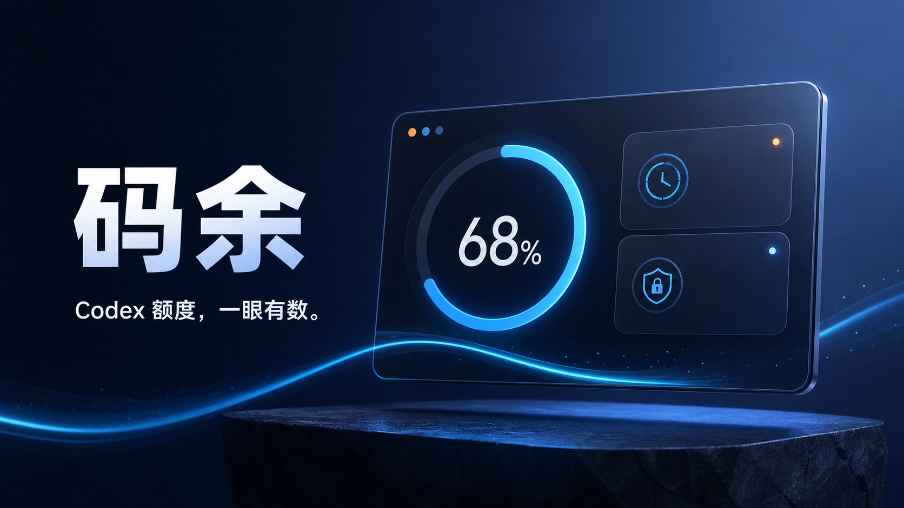

<p align="center">
  
</p>

<h1 align="center">码余</h1>

<p align="center">
  <strong>Codex 额度，一眼有数。</strong><br />
  <span>一款本地优先、非官方的 macOS 菜单栏 / Windows 系统托盘工具。</span>
</p>

<p align="center">
  <a href="https://github.com/codex-quota-tools/codex-quota-tracker/releases/latest"></a>
  <a href="https://github.com/codex-quota-tools/codex-quota-tracker/actions/workflows/ci.yml"></a>
  
  
  <a href="LICENSE"></a>
</p>

<p align="center">
  <a href="https://github.com/codex-quota-tools/codex-quota-tracker/releases/latest"><strong>下载安装包</strong></a>
  ·
  <a href="docs/USAGE.md">使用说明</a>
  ·
  <a href="docs/PRIVACY.md">隐私说明</a>
  ·
  <a href="docs/DEVELOPMENT.md">参与开发</a>
</p>

额度快见底时，最麻烦的不是数字变成 0，而是写到一半才发现。码余把 Codex 剩余额度放进菜单栏或系统托盘：点一下，就能看到剩余百分比、北京时间重置日期和最近的 Token 活动。

它直接连接本机 Codex CLI App Server。没有项目 API Key，没有中转服务器，也不会把账户数据发给项目维护者。

## 为什么用码余

| | |
| --- | --- |
| **抬眼就能看到额度** | 状态栏常驻显示剩余百分比，不必反复打开账户页面。 |
| **重置时间不用自己换算** | 美国时间自动转换为北京时间，日期和时刻放在同一张卡片里。 |
| **数据留在自己的电脑** | 额度在运行时读取，设置与手动积分保存在本机；项目没有云端账户系统。 |
| **不只看一个百分比** | 可查看套餐信息、Token 统计与最近 12 周活动，了解自己的使用节奏。 |
| **WorkBuddy 也有位置** | 可手动记录剩余积分；不抓 Cookie，不调用非公开余额接口。 |
| **看起来像桌面工具** | 紧凑面板、浅色 / 深色模式、低额度提醒和自定义状态栏名称。 |

## 下载与安装

前往 [Releases](https://github.com/codex-quota-tools/codex-quota-tracker/releases/latest) 下载最新版本：

- macOS Apple Silicon：选择 `.dmg`
- Windows x64：选择 `Windows_x64-setup.exe`
- 希望核对文件完整性：同时下载 `SHA256SUMS.txt`

当前安装包尚未使用付费的 Apple Developer / Windows 代码签名证书，因此系统第一次打开时可能提示未知开发者。请只从本仓库下载，并核对 Release 中的 SHA-256。

## 三步开始

1. 安装并启动码余。
2. 如果本机尚未登录 Codex，按界面提示完成官方设备登录。
3. 点击菜单栏或系统托盘里的 `Codex 额度 xx%` 查看面板。

应用每 60 分钟自动刷新，也可以在额度卡片中立即同步。设置里可修改状态栏文字、主题、通知和开机启动。

## 它如何工作

```text
本机 Codex CLI App Server
           │
           │ 额度、重置时间、使用统计
           ▼
       码余桌面应用
           │
           ├── 菜单栏 / 系统托盘
           └── 本机 data.json（设置与手动积分）
```

码余不代理请求，也没有需要信任的第三方后端。Codex 登录凭据仍由官方 Codex CLI 管理，本项目不读取或保存凭据文件。

## 隐私边界

| 数据 | 来源 | 保存位置 | 上传给项目服务器 |
| --- | --- | --- | --- |
| Codex 额度与使用统计 | 本机 Codex CLI App Server | 运行时内存 | 否；项目没有服务器 |
| Codex 登录凭据 | 官方 Codex CLI | Codex 自己的本机目录 | 本项目不读取 |
| WorkBuddy 积分 | 用户手动输入 | 本机 `data.json` | 否 |
| 主题、提醒与显示名称 | 用户设置 | 本机 `data.json` | 否 |

源码和 GitHub Actions 不需要个人 API Key，也不应提交访问令牌、Codex 登录文件或浏览器 Cookie。详细边界见 [隐私说明](docs/PRIVACY.md) 和 [安全策略](SECURITY.md)。

## 从源码运行

环境要求：Node.js 22、Rust stable，以及对应平台的原生构建工具。

```bash
git clone https://github.com/codex-quota-tools/codex-quota-tracker.git
cd codex-quota-tracker
npm ci
npm install --no-save @openai/codex@0.146.0-alpha.9
npm run sidecar
npm test
cargo test --manifest-path src-tauri/Cargo.toml
npm run tauri dev
```

如果本机已经安装可用的 Codex CLI，可跳过临时 NPM 安装；`npm run sidecar` 会尝试发现本机二进制。Windows 也可以运行：

```powershell
.\scripts\build-windows.ps1
```

完整构建流程见 [开发指南](docs/DEVELOPMENT.md)。

## 常用命令

```bash
npm run dev        # 网页界面预览
npm run build      # 检查并构建前端
npm test           # 前端单元测试
npm run sidecar    # 准备当前平台的 Codex CLI
npm run tauri dev  # 启动完整桌面应用
```

## 项目结构

```text
src/                         React 界面与格式化逻辑
src-tauri/src/               Rust 桌面运行时与 Codex App Server 通信
scripts/                     Sidecar 准备、冒烟测试和 Windows 构建脚本
docs/                        使用、隐私与开发文档
.github/workflows/           CI 与跨平台安装包构建
assets/                      原创图标与项目图片
```

## 已知限制

- 当前提供 Apple Silicon macOS 与 x64 Windows 安装包。
- WorkBuddy 没有公开稳定的余额接口，因此只支持本地手动记录。
- Codex App Server 会随 Codex CLI 更新，升级 CLI 后需要重新验证消息结构。
- 未购买平台代码签名证书，安装时可能出现系统安全提醒。

## 参与项目

发现问题可以直接提交 [Issue](https://github.com/codex-quota-tools/codex-quota-tracker/issues)。准备贡献代码前，请阅读 [贡献指南](CONTRIBUTING.md) 和 [行为准则](CODE_OF_CONDUCT.md)。安全问题不要公开提交 Issue，处理方式见 [SECURITY.md](SECURITY.md)。

项目代码采用 [MIT License](LICENSE)。构建中使用的 OpenAI Codex CLI 采用 Apache-2.0，完整声明见 [THIRD_PARTY_NOTICES.md](THIRD_PARTY_NOTICES.md)。

> 码余是独立的非官方项目，与 OpenAI 没有隶属、赞助或官方背书关系。“Codex”和“OpenAI”是其各自权利人的商标。
